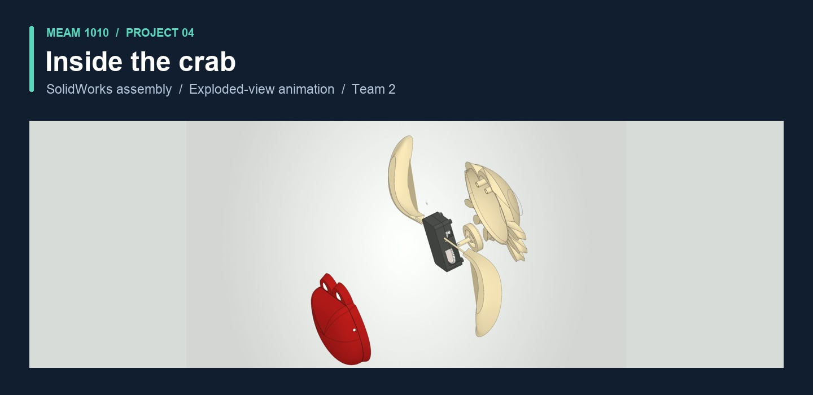
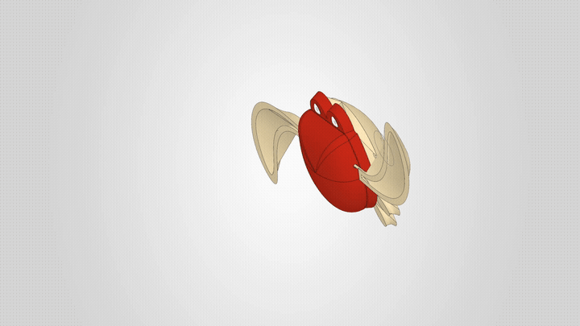

# MEAM 1010 — CAD

SolidWorks exercises and design projects by **Kirill Nekryukov**.

## Featured project · Inside the crab

A look inside the crab assembly, from its outer shell to the internal gearbox and moving components.

**[▶ Watch the full animation](projects/P4-Dissect/media/1010-105-P4_Dissect-Team2.mp4)** · **[Explore the project](projects/P4-Dissect/)**  
20 seconds · 1080p · Team 2

## Design portfolio

| Project | Explore |
| :--- | :--- |
| **P1 · Puzzle** | [Assembly and parts](projects/P1-Puzzle/source/) |
| **P2 · Fidget** | [Assembly, printable part and cutting drawing](projects/P2-Fidget/source/) |
| **P3 · Lighthouse** | [Assembly and components](projects/P3-Lighthouse/source/) |
| **P4 · Dissect** | [Crab animation and gearbox CAD](projects/P4-Dissect/) |
| **Exercises · E01–E08** | [Crank, Cube, Pulley, Piston, Mug, Vase, CSWA and Drawing](exercises/) |

## Working with the CAD files

Open assemblies together with their accompanying parts. CAD filenames inside assemblies are preserved. File organization was checked; assemblies have not been opened or rebuilt in SolidWorks.

Exact duplicates were selected by latest filesystem modification time. Distinct archived versions and additional parts are kept in the [private Penn archive](https://drive.google.com/drive/folders/1wc4ktC-ck_fceN-RVcpjVlg8m3RwiclM).
