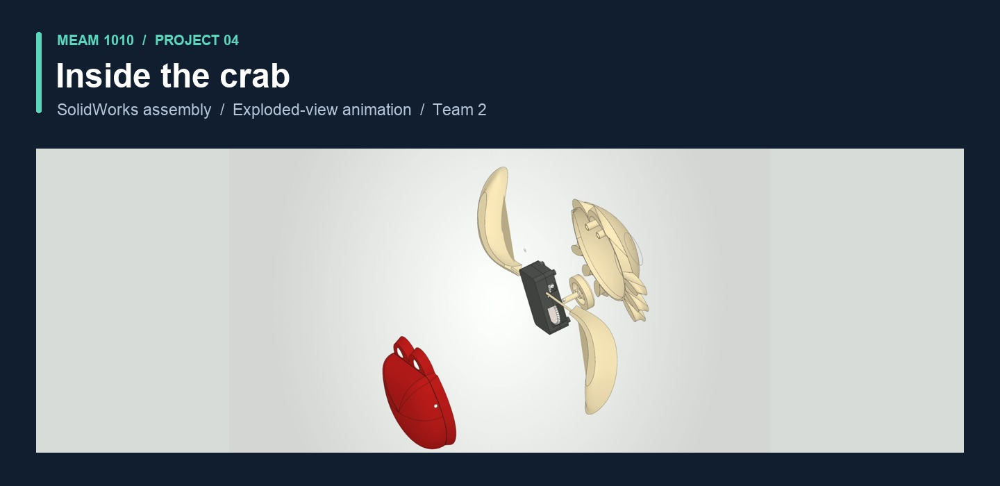
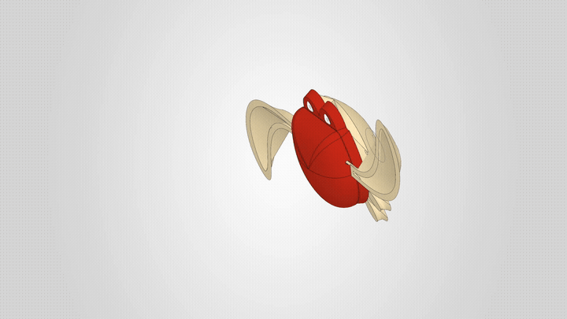

# P4 · Dissect — Inside the crab

**MEAM 1010 · Team 2 · SolidWorks**

The animation separates the crab assembly to reveal its shell, internal gearbox, shafts and other components.

## Watch the assembly

**[▶ Watch the full 1080p video](media/1010-105-P4_Dissect-Team2.mp4)**  
20 seconds · MP4 · Original video, preserved without re-encoding

## Project files

| File | Description |
| :--- | :--- |
| [Full animation](media/1010-105-P4_Dissect-Team2.mp4) | Original Team 2 CAD demonstration |
| [Gearbox assembly](source/gearsassembly%20%282%29.SLDASM) | SolidWorks assembly |
| [Gearbox](source/gearbox.SLDPRT) | SolidWorks part |
| [Shaft 1](source/shaft1.SLDPRT) · [Shaft 2](source/shaft2.SLDPRT) | Shaft components |

Keep the assembly and its accompanying parts together when opening in SolidWorks. Additional parts and archived versions are in the [private Penn archive](https://drive.google.com/drive/folders/1wc4ktC-ck_fceN-RVcpjVlg8m3RwiclM).

[← Back to the CAD portfolio](../../README.md)
